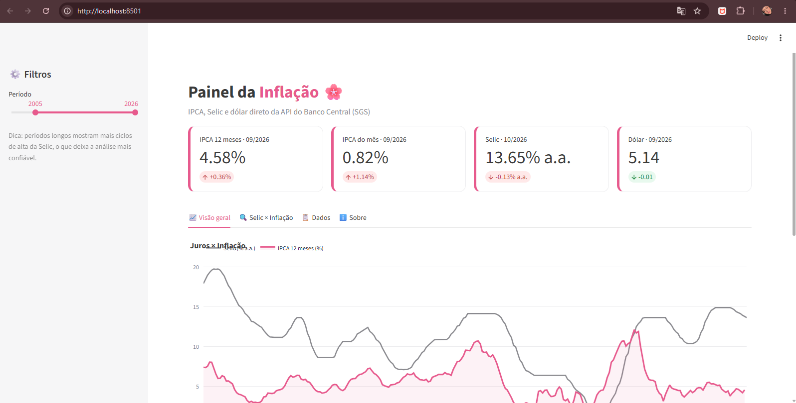
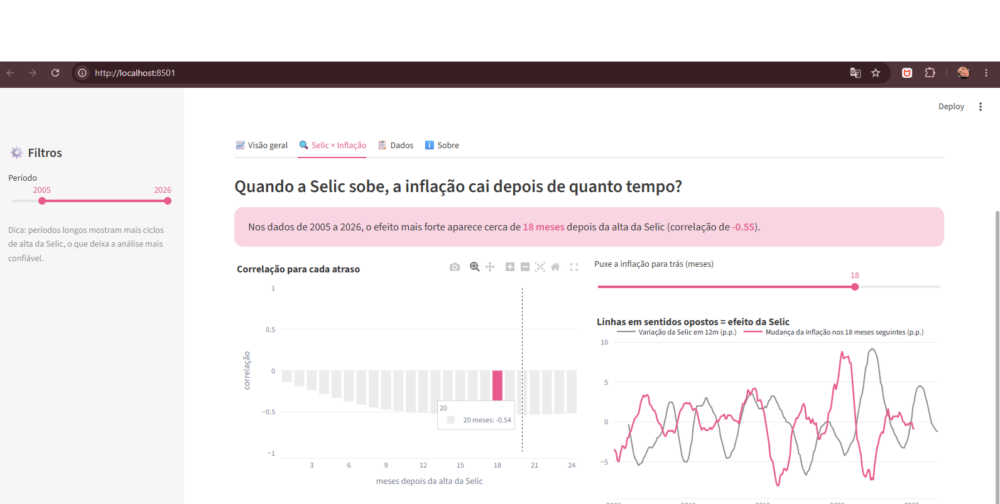

# 🌸 Painel da Inflação

Painel interativo feito em **Python** que mostra a inflação (IPCA), a taxa Selic e o dólar, usando dados oficiais e gratuitos do **Banco Central do Brasil**.

O painel também tenta responder a uma pergunta:

> **Quando a Selic sobe, depois de quanto tempo a inflação cai?**

## ✨ O que o painel mostra

- **Cartões com os números mais recentes:** inflação em 12 meses, inflação do mês, Selic e dólar
- **Visão geral:** gráficos de juros × inflação, inflação mês a mês e dólar
- **Selic × Inflação:** uma análise que descobre depois de quantos meses a alta da Selic tem o maior efeito na inflação
- **Dados:** tabela completa com botão para baixar em CSV (abre no Excel)
- **Filtro de período:** você escolhe os anos que quer analisar

## 🛠️ Tecnologias usadas

| Ferramenta | Para que serve |
|---|---|
| [Python](https://www.python.org/) | Linguagem de programação do projeto |
| [Streamlit](https://streamlit.io/) | Transforma o código Python em um site interativo |
| [Pandas](https://pandas.pydata.org/) | Organiza os dados em tabelas e faz os cálculos |
| [Plotly](https://plotly.com/python/) | Desenha os gráficos interativos |
| [Requests](https://requests.readthedocs.io/) | Busca os dados na API do Banco Central |

## 🚀 Como rodar no seu computador

1. Instale o [Python](https://www.python.org/downloads/) (no Windows, marque a opção **"Add Python to PATH"**).

2. Baixe este projeto clicando no botão verde **Code → Download ZIP** e descompacte a pasta. Ou, se você usa Git:

```bash
git clone https://github.com/raphaelamarquesvanti/projeto-inflacao-bc.git
cd projeto-inflacao-bc
```

3. Instale as bibliotecas:

```bash
pip install -r requirements.txt
```

4. Ligue o painel:

```bash
streamlit run app.py
```

5. O navegador abre sozinho em `http://localhost:8501`. 🎉 (Se a porta estiver ocupada, o Streamlit usa outra, como `8502`, e mostra o endereço certo no terminal.)

> 💡 **Atalho no Windows:** dê dois cliques no arquivo `ABRIR_PAINEL.BAT` para abrir o painel sem usar o terminal.

## 📊 De onde vêm os dados

Todos os dados vêm da **API do SGS** (Sistema Gerenciador de Séries Temporais) do [Banco Central do Brasil](https://dadosabertos.bcb.gov.br/). Ela é gratuita e não precisa de cadastro nem senha.

| Indicador | Código SGS |
|---|---|
| IPCA: variação mensal (%) | 433 |
| IPCA: acumulado em 12 meses (%) | 13522 |
| Selic: acumulada no mês, anualizada (% a.a.) | 4189 |
| Dólar (venda): média mensal (R$) | 3698 |

Exemplo de pedido à API (as últimas 5 inflações mensais):

https://api.bcb.gov.br/dados/serie/bcdata.sgs.433/dados/ultimos/5?formato=json


> ⚠️ A análise mostra uma **correlação**, não uma prova de causa. Outros fatores, como câmbio, alimentos e energia, também mexem na inflação.




